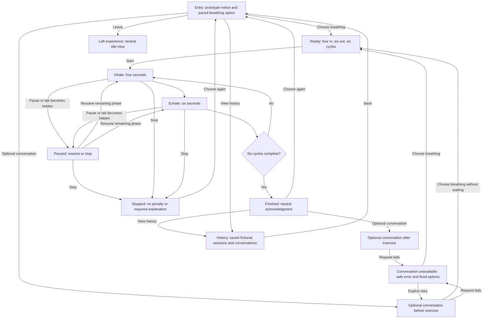

# Assignment 3.1 — Paced breathing experience

Updated: October 12, 2026.

Status: design proposal based on the student's selected scope. No interface or
timing behavior in this document has been implemented or tested.

## Purpose and scope

Design a localhost coursework prototype with one initial skill: six cycles of
four-second inhalation and six-second exhalation, targeting 60 active seconds.
Optional model conversation is available before or after the exercise. Starting
and completing breathing requires neither typing nor a successful model call.

Use only fictional scenarios for evaluation and demonstration. The interface
states: "Coursework skills prototype. For fictional testing only. This is not
therapy or monitored support." Keep a compact version of this identification
visible within the exercise; put the fuller explanation on entry.

The study informs interaction design, not a claim of clinical effectiveness.
The [planning notes](assignment3-part1-plan.md) record the supplied findings and
their evidence counts.

## Main experience flow



Diagram arrows show the main transitions, not every global control. The global
rules below apply to **every** node, including paused, failed, history, and idle
views. Retry returns to the original before/after conversation context; the
diagram's retry arrow illustrates the before-exercise case.

### Controls available throughout

- **Crisis support:** a persistent, clearly labeled link opens a locally rendered
  support panel directly. It works without the model, a classifier, or an API
  response. The panel's resource text remains available if the backend is down;
  contacting an external service still depends on connectivity and that service.
- **Leave:** immediately ends participation and shows the neutral idle view.
  During breathing it stops the cue and marks the session as stopped. No
  confirmation, explanation, score, or model response is required.
- **Simpler view / Show more:** user-selected presentation, never inferred
  distress. Simpler view hides history previews, secondary explanations, and
  conversation suggestions. It retains the current instruction, pause/stop,
  leave, prototype identity, and crisis link. Optional features remain reachable
  through Show more.

Opening Crisis support during breathing pauses the exercise. Returning keeps it
paused until Resume is chosen, with the saved phase and remaining phase time.
The support panel offers clear Back and Leave controls and takes keyboard focus.
The persistent link remains visible and unobscured on small screens, with no
scrolling needed to locate it. The student selected U.S. resources. The
[resource notes](assignment3-part1-resources.md) record listed contacts, official
source inspection, and remaining copy/link verification limits.

## Screen sketch and interaction details

The breathing view has one central action cue. Global controls occupy a stable
location rather than a second competing task.

```text
┌───────────────────────────────────────────────┐
│ Coursework prototype          Crisis support │
│                                               │
│                   Inhale                      │
│                4-second phase                 │
│            [subtle pacing circle]             │
│                  Cycle 1 of 6                 │
│                                               │
│              Pause       Stop                 │
│                                               │
│ Simpler view                         Leave    │
└───────────────────────────────────────────────┘
```

This is a structural sketch, not a final color or accessibility specification.

| View | Main content and choices | Reading, typing, and control |
| --- | --- | --- |
| Entry | Prototype notice; one breathing option labeled "60 seconds"; optional conversation and history. | No distress questionnaire or required disclosure. No automatic start. |
| Ready | Overview: "Six cycles: 4-second inhale, 6-second exhale. Pause or stop is available." Start button. | Preview/setup only; no cue asks the user to begin breathing yet. User decides when to start. |
| Inhale/exhale | One phase label; gentle cue; cycle count; Pause and Stop. | No chat overlay, mandatory input, coaching essay, or model wait. |
| Paused | "Paused"; Resume and Stop. | No automatic resume or countdown while paused. |
| Stopped | "Exercise stopped. You can leave or choose again." | No failure label, lost streak, required reason, or automatic restart. |
| Finished | "Exercise finished." Optional conversation, history, or leave. | No claim that the person feels better. No mandatory rating. |
| Conversation | Optional fictional message and concise model reply; direct breathing/back controls. | Explain that messages are saved locally and sent to the configured model provider. Allow skipping at any time. |
| Request failure | "Conversation is unavailable. You can try again or continue without it." | Explicit retry only; preserve the fictional draft in the current view. Ignore late replies after leaving. |
| History | Date, skill, completed/stopped/interrupted status, active duration; conversations opened on demand. | No automatic display of sensitive-looking message previews, ratings, or inferred emotional state. |
| Crisis panel | Locally bundled, verified support information with geographic scope; Back and Leave. | Direct access even during a pending or failed model request. No chatbot gate. |

When a tab becomes hidden, pause the exercise to avoid silently skipping cues.
When a page is closed or refreshed, do not auto-resume motion: a restored session
is interrupted and may be reviewed or restarted by choice. Persistence failures
must not trap the user; indicate that a record could not be saved while keeping
exercise and exit controls usable.

## Timing, motion, and accessibility

The planned sequence is `(4 + 6) × 6 = 60` seconds of active instruction. The
first Inhale cue starts the measurement; the final Exhale ending and appearance
of the finished view end it. There is no preparatory countdown inside this
sequence, no reading checkpoint between cycles, and no model request in it.
Transitions must not insert extra timed holds. Measure actual display timing,
including application delays, rather than claiming a configured timer proves
the duration. The intended uninterrupted sequence must remain at most 90 seconds.

Record entry/setup separately, including optional before-exercise conversation.
The Ready overview describes the sequence; the first actionable guided
instruction is the rendered Inhale cue after Start. Do not put guided breathing
instructions or required reading after Start outside the measured interval.
Record pauses and time in crisis resources separately from active exercise time.
Resume continues the remaining time in the same phase; it does not jump phases
or add a mandatory full cycle. Do not force departure after the planned sequence.

Use muted colors with readable contrast and no flashing, celebratory animation,
or sudden sound. A small expanding/contracting cue may carry the pace. With
reduced motion or a user-selected static option, use a stationary cue with the
phase label and remaining seconds. Phase announcements should be useful to a
screen reader without announcing every timer tick. All actions must be keyboard
accessible with visible focus. No speech feature is proposed for this version.
These are acceptance intentions, not verified accessibility claims.

## Model contribution and boundaries

The optional model can select reviewed replies that acknowledge a fictional
message and describe the available exercise using approved context. After the
exercise it can select a relevant display-option fact, without claiming benefit
or deciding a preference automatically. This demonstrates contextual conversation
without asking the model to conduct therapy or rewrite a skill.

Only reviewed skill material and an explicitly bounded set of that conversation's
saved messages/preferences should enter the request. Do not send the whole
history by default. The model must not diagnose, invent therapeutic advice,
change the 4–6 sequence, alter timing, control navigation, or assert that someone
is monitoring the user. It cannot choose a skill or save a preference on the
user's behalf. The [technical design](assignment3-part1-technical.md) specifies
the selected reply/fact allowlist and fallback boundary; prompt instructions
alone are insufficient enforcement. No free-form model prose is rendered.

For fictional crisis-related messages, plan to keep the fixed crisis route
visible and instruct the model to refer briefly to that route rather than
provide individualized crisis counseling. No clinical detector or automatic
distress routing is proposed. Model interpretation may miss or misread text;
therefore it is not the mechanism that exposes support information. A failed or
rejected response uses fixed application text and never hides the support link.
Neither conversation nor detection is required to open the panel.

## Research rationale and tradeoffs

| Finding | Design decision and reasoning | Alternative and cost |
| --- | --- | --- |
| R1 — short exercises | Six 10-second cycles target 60 seconds; conversation stays outside the guided sequence. Measure rendering delays through the final step. | A longer exercise offers more cycles but conflicts with attention findings. Short duration does not establish effectiveness. |
| R2 — frictionless crisis access | One persistent labeled link opens bundled information directly from every view. | A safety menu saves screen space but adds navigation. A visible link occupies space intentionally. |
| R3 — permission to stop | Pause, Stop, and Leave are explicit; stopping has no penalty, explanation, or confirmation. | Confirmation may prevent accidental stops but adds effort. Immediate stopping is chosen; restarting is voluntary. |
| R4 — user controls journey | User selects breathing, optional conversation, history, or leave; no automatic routing or start. | One implemented skill limits skill choice. Declining is a real option; the app does not pretend to offer unimplemented skills. Broader skill choice is deferred. |
| D1 — interface contraction | User selects Simpler view and can reverse it. Hide secondary content while preserving safety and controls. | Automatic contraction might reduce effort but requires an unsupported distress inference and can remove control. Manual selection adds one action. |
| D2 — one atomic action | Only the current inhale or exhale instruction appears in the exercise center. Chat and history stay outside it. | A full sequence or dashboard may aid overview but competes with the current action. Stable safety/exit controls remain necessary exceptions. |
| D3 — minimize emotional cost | No distress rating, required message, emotional explanation, or completion feedback. No obligatory typing during breathing. | Less feedback limits personalization and learning about user experience. Optional preference choices can provide modest information without demanding disclosure. |
| D4 — persistently visible safety | Safety access survives exercise, pause, history, simpler view, loading, and failure states. | Full-screen minimalism could remove distractions but would remove a control participants noticed missing. |
| D5 — low-burden personalization | Remember explicit presentation choices; offer a one-click "Use last setup" after prior use, never auto-start. Make reset/change available. | An onboarding preference questionnaire provides richer data but adds effort. Prior completion is not treated as proof the user liked the skill. |
| D6 — low stimulus and neutral language | Muted visual pacing, static alternative, short literal phase labels, neutral stopped/finished text. | Bright rewards may reinforce engagement but introduce stimulation and pressure. Restrained visuals may feel less expressive. |

Personalization remains deliberately modest: prefer user-approved display settings
and a voluntarily reused setup over inferred feelings. A last-used setup is a
convenience, not a recommendation. With only one skill, it mainly saves display
choices; it does not create meaningful multi-skill personalization. History may
show prior participation but cannot establish improvement or distress level.

## Design review scenarios for later verification

These are proposed checks, not observed results and not the complete fifteen-case
final evaluation.

1. Fictional user chooses breathing without chatting: six cycles complete with
   no provider request during the sequence and duration at most 90 seconds.
2. User pauses during an exhale, waits, and resumes: the remaining phase time
   continues; pause duration is excluded and no automatic resume occurs.
3. User stops after two cycles: motion stops immediately, the record is stopped,
   and there is no penalty, forced reflection, or restart.
4. Optional model request fails: fixed options and crisis access remain usable;
   no automatic paid retry occurs.
5. User opens Crisis support while breathing: the panel opens directly, pacing
   pauses, and returning does not resume automatically.
6. User enables simpler view or reduced motion: the current cue remains usable
   and safety/exit controls remain visible and keyboard accessible.
7. User closes or refreshes mid-exercise: restore an interrupted record without
   silently completing the session or restarting the cue.
8. A late model reply arrives after leaving: it does not reopen conversation,
   change the active view, or overwrite the current exercise state.

## Remaining decisions and next step

The selected skill, optional conversation placement, repository organization,
U.S. resource scope, and constrained replies are confirmed by the student.
The [technical design](assignment3-part1-technical.md) specifies SQLite records,
model context/response limits, timing, failure handling, and code organization.
The experience and implementation details still need student review.
Identify which hotel-app patterns can be adapted without reusing hotel-specific
prompts, SQL-generation behavior, or data. No new dependency is selected here.

Evidence: this design was generated from the assignment text, the supplied R/D
table, and the student's explicit scope prompt. It is reasoning and planning
evidence, not a browser demonstration, runtime measurement, or clinical finding.
